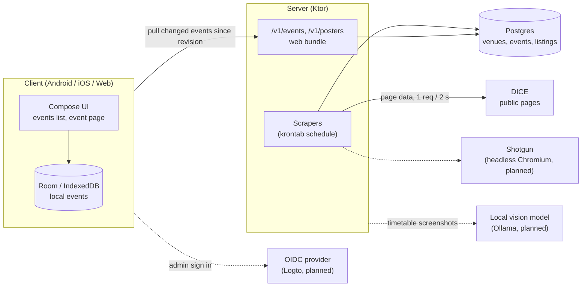

# TimeTabler

The exact lineup and set times of music events, starting with Paris club nights. Lineups come from
DICE (and later Shotgun and festival feeds); set times come from the timetables promoters post in
their Instagram stories.

Kotlin Multiplatform app (Android, iOS, web) with a Ktor server that scrapes events into Postgres and
feeds every client's offline store.

## Architecture

TimeTabler is a Kotlin Multiplatform client (Android, iOS and web) fed by a Ktor server. Only the
server talks to ticketing sites; each client keeps its own local copy of the events and stays
usable offline.



- The **server** scrapes DICE's public pages on a schedule, keeps one row per event in
  **Postgres**, and gives every change a new revision.
- The **client** pulls the events changed since its last revision into its local database (Room
  on Android and iOS, IndexedDB on web) and renders only from there, so it works offline.
- Ticket buttons open the DICE or Shotgun page; the app itself never calls those sites.
- Dashed parts are planned: Shotgun scraping, admin login to add timetables, and reading set
  times from story screenshots with a local vision model.

## Run locally

```sh
git config core.hooksPath .githooks        # format check on commit
docker run -d --name tt-postgres -e POSTGRES_PASSWORD=tt -e POSTGRES_USER=tt -e POSTGRES_DB=tt -p 5432:5432 postgres:16
TT_DB_URL=jdbc:postgresql://localhost:5432/tt TT_DB_USER=tt TT_DB_PASSWORD=tt ./gradlew :server:run
./gradlew :composeApp:wasmJsBrowserDevelopmentRun   # web client
./gradlew :androidApp:installDebug                  # Android client
```

## License

GPL-3.0, see [LICENSE](LICENSE).
